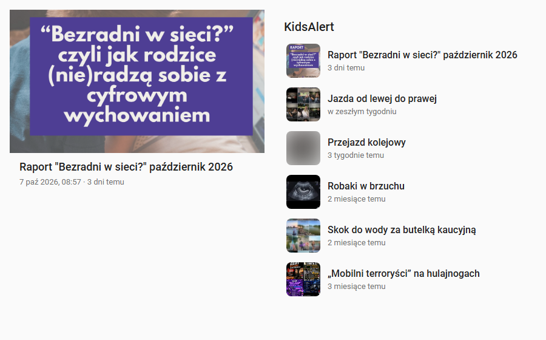
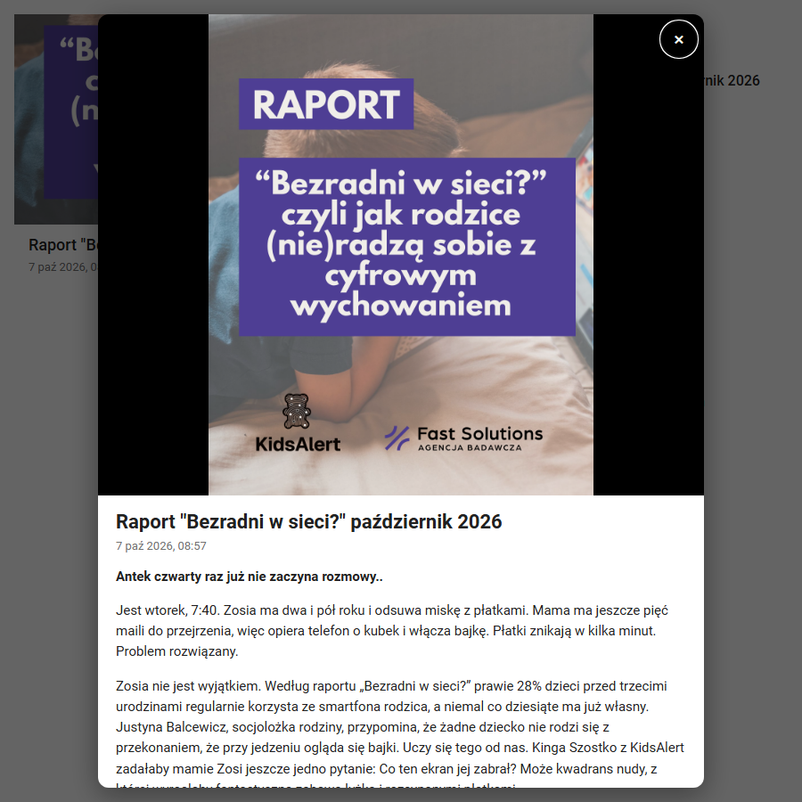

<p align="center">
  
</p>

<h1 align="center">KidsAlert dla Home Assistant</h1>

<p align="center">
  Alerty o zagrożeniach dla dzieci w sieci i poza nią z <a href="https://kidsalert.pl">kidsalert.pl</a>
  jako encje Home Assistant, zdarzenia do automatyzacji i dwie karty dashboardu instalowane razem z integracją.
</p>

<p align="center"><b>🇬🇧 <a href="README.md">English documentation</a></b></p>



> [!NOTE]
> To nieoficjalna integracja społecznościowa, niezwiązana z KidsAlert ani przez nią nieautoryzowana.
> Korzysta z tego samego publicznego API tylko do odczytu, którego używa aplikacja mobilna KidsAlert.
> Teksty i obrazy alertów należą do KidsAlert.

## Co potrafi

- **Sensor „Ostatni alert”**: tytuł najnowszego alertu jako stan, a obrazek, flaga zagrożenia i czas wysłania w atrybutach.
- **Czujnik binarny „Alert o zagrożeniu”**: włączony przez ustawioną liczbę godzin po alercie o zagrożeniu.
- **Encja zdarzeń „Nowy alert”** i zdarzenie `kidsalert_new_alert` z tytułem, fragmentem treści i obrazkiem, gotowe do powiadomień.
- **Dwie karty dashboardu wbudowane w integrację**: bez osobnej instalacji i bez dodawania zasobów. Kliknięcie alertu otwiera pełną treść, zdjęcie i wideo.
- **Blueprint powiadomień**: powiadomienie na telefon z obrazkiem, fragmentem treści i linkiem do dashboardu, opcjonalnie tylko dla zagrożeń.
- Alerty opublikowane, gdy Home Assistant był wyłączony, zostaną ogłoszone po jego starcie (do dziesięciu najnowszych).
- Alerty po polsku albo angielsku, interfejs w obu językach.
- Diagnostyka do pobrania, ikony dla jasnego i ciemnego motywu, testy na najstarszej i najnowszej obsługiwanej wersji Home Assistant.

## Instalacja

### HACS (zalecane)

[](https://my.home-assistant.io/redirect/hacs_repository/?owner=MichalZaniewicz&repository=ha-kidsalert&category=integration)

1. HACS → ⋮ → **Niestandardowe repozytoria** → dodaj `https://github.com/MichalZaniewicz/ha-kidsalert` jako **Integracja**.
2. Zainstaluj **KidsAlert** i zrestartuj Home Assistant.

### Ręcznie

Skopiuj `custom_components/kidsalert` z [najnowszego wydania](https://github.com/MichalZaniewicz/ha-kidsalert/releases/latest) (`kidsalert.zip`) do `<config>/custom_components/kidsalert` i zrestartuj Home Assistant.

Wymagany Home Assistant **2025.3** lub nowszy.

## Konfiguracja

[](https://my.home-assistant.io/redirect/config_flow_start/?domain=kidsalert)

**Ustawienia → Urządzenia i usługi → Dodaj integrację → KidsAlert**, a następnie wybierz język alertów. Integrację można dodać raz dla każdego języka.

Przycisk **Konfiguruj** przy integracji pozwala ustawić:

| Opcja | Domyślnie | Zakres |
| --- | --- | --- |
| Sprawdzaj nowe alerty co | 10 min | 5–120 min |
| Czujnik zagrożenia włączony przez | 24 h | 1–168 h |

## Encje

Identyfikatory encji zależą od języka Home Assistant. Poniższe przykłady dotyczą polskiego interfejsu i polskich alertów.

| Encja | Stan | Atrybuty |
| --- | --- | --- |
| `sensor.kidsalert_pl_ostatni_alert` | Tytuł najnowszego alertu | `alert_id`, `is_danger`, `is_sensitive`, `image`, `thumbnail`, `sent_at`, `language` |
| `binary_sensor.kidsalert_pl_alert_o_zagrozeniu` | `on`, gdy alert o zagrożeniu jest młodszy niż ustawione okno | `alert_id`, `title`, `sent_at`, `window_hours` |
| `event.kidsalert_pl_nowy_alert` | Czas ostatniego nowego alertu; typy zdarzeń `alert` i `danger_alert` | `alert_id`, `title`, `content`, `is_danger`, `is_sensitive`, `image`, `thumbnail`, `sent_at` |

### Zdarzenie `kidsalert_new_alert`

Wysyłane raz dla każdego nowego alertu, od najstarszego:

```yaml
event_type: kidsalert_new_alert
data:
  config_entry_id: 01J…
  alert_id: 177
  title: "TO NIE JEST CHALLENGE - ale jest gra..."
  content: "Fragment treści bez HTML, do 500 znaków"
  is_danger: true
  is_sensitive: false
  image: https://kidsalert.pl/media/alerts/….jpeg
  thumbnail: https://kidsalert.pl/media/alerts/….200x200_q85.jpg
  sent_at: "2026-10-08T15:00:51.947675+02:00"
```

Przy pierwszym uruchomieniu istniejące alerty nie są ogłaszane. Potem integracja zapamiętuje najnowszy widziany alert, więc restart niczego nie powtarza ani nie gubi.

## Karty dashboardu

Karty ładują się automatycznie razem z integracją. Otwórz dashboard, kliknij **Dodaj kartę** i wyszukaj **KidsAlert**. Obie karty mają edytor wizualny.



### Ostatni alert: `custom:kidsalert-card`

```yaml
type: custom:kidsalert-card
entity: sensor.kidsalert_pl_ostatni_alert
```

| Opcja | Domyślnie | Opis |
| --- | --- | --- |
| `entity` | pierwszy sensor KidsAlert | Sensor „Ostatni alert” wpisu, który karta ma pokazywać |
| `title` | brak | Nagłówek karty |
| `show_image` | `true` | Pokazuj obrazek alertu |
| `blur_sensitive` | `true` | Rozmywaj obrazy alertów oznaczonych jako wrażliwe |

### Lista alertów: `custom:kidsalert-list-card`

```yaml
type: custom:kidsalert-list-card
entity: sensor.kidsalert_pl_ostatni_alert
count: 5
only_danger: false
```

| Opcja | Domyślnie | Opis |
| --- | --- | --- |
| `entity` | pierwszy sensor KidsAlert | Sensor „Ostatni alert” wpisu, który karta ma pokazywać |
| `title` | `KidsAlert` | Nagłówek karty |
| `count` | `5` | Liczba alertów (1–30) |
| `only_danger` | `false` | Tylko alerty o zagrożeniu |
| `show_thumbnails` | `true` | Pokazuj miniatury |
| `blur_sensitive` | `true` | Rozmywaj miniatury alertów wrażliwych |

Treść alertów pochodzi z zewnętrznego serwera, więc karty przed wyświetleniem filtrują ją według listy dozwolonych elementów. Skrypty, ramki, atrybuty `on*` i linki inne niż HTTP są usuwane.

## Powiadomienia

[](https://my.home-assistant.io/redirect/blueprint_import/?blueprint_url=https%3A%2F%2Fgithub.com%2FMichalZaniewicz%2Fha-kidsalert%2Fblob%2Fmain%2Fblueprints%2Fautomation%2Fkidsalert%2Fnotify_new_alert.yaml)

Blueprint wysyła powiadomienie dowolną akcją `notify` (aplikacja mobilna, grupa, Telegram…) z obrazkiem, fragmentem treści i opcjonalnym dashboardem otwieranym po kliknięciu. Można go ograniczyć do alertów o zagrożeniu.

Albo napisz automatyzację samodzielnie:

```yaml
triggers:
  - trigger: event
    event_type: kidsalert_new_alert
    event_data:
      is_danger: true
actions:
  - action: notify.mobile_app_moj_telefon
    data:
      title: "⚠️ KidsAlert"
      message: "{{ trigger.event.data.title }}"
      data:
        image: "{{ trigger.event.data.image }}"
```

## Jak to działa

Integracja odpytuje `GET https://kidsalert.pl/alerts/?lang=<pl|en>`, czyli ten sam endpoint, z którego korzysta aplikacja mobilna. Pełna treść alertu (`/alerts/<id>/`) jest pobierana tylko dla nowych alertów i przy otwarciu alertu w karcie, a potem trzymana w pamięci podręcznej. Integracja nie używa konta ani danych osobowych. Minimalny odstęp między zapytaniami to pięć minut, żeby nie obciążać serwisu prowadzonego przez organizację non-profit.

## Rozwiązywanie problemów

- **Brak kart w wyborze kart**: odśwież kartę przeglądarki albo wyczyść pamięć podręczną frontendu w ustawieniach aplikacji Companion. Karty są rejestrowane przy starcie integracji.
- **„Nie znaleziono integracji KidsAlert” w karcie**: integracja nie jest skonfigurowana albo `entity` w karcie wskazuje inny sensor.
- **Diagnostyka**: Ustawienia → Urządzenia i usługi → KidsAlert → ⋮ → **Pobierz diagnostykę**. Dołącz plik do [zgłoszenia](https://github.com/MichalZaniewicz/ha-kidsalert/issues).
- **Logi debugowania**:

  ```yaml
  logger:
    logs:
      custom_components.kidsalert: debug
  ```

## Rozwój

Home Assistant nie działa na Windowsie, więc używaj Linuksa, macOS, WSL albo dev containera.

```bash
python3.14 -m venv .venv && source .venv/bin/activate
pip install -r requirements_test.txt
pytest --cov
ruff check . && ruff format --check .
```

`requirements_test_min.txt` uruchamia te same testy na Home Assistant 2025.3, najstarszej obsługiwanej wersji.

**Wydanie nowej wersji**: zmień numer wersji w `manifest.json`, `const.py`, `kidsalert-card.js` i `pyproject.toml` (test pilnuje, żeby były zgodne), uzupełnij `CHANGELOG.md` i opublikuj wydanie na GitHubie z tagiem `vX.Y.Z`. Workflow sprawdzi tag i dołączy `kidsalert.zip` dla HACS.

## Licencja

[MIT](LICENSE). Nazwa, logo i treści KidsAlert należą do ich właścicieli.
